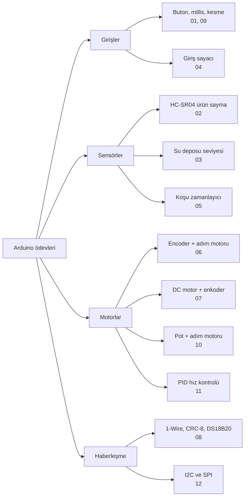
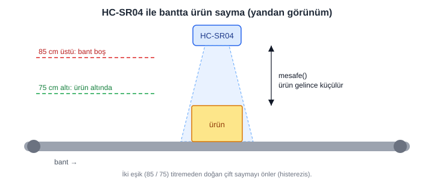
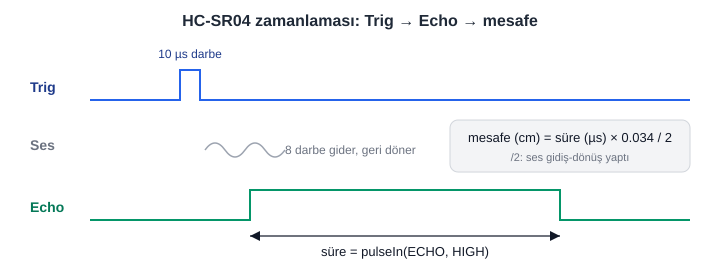
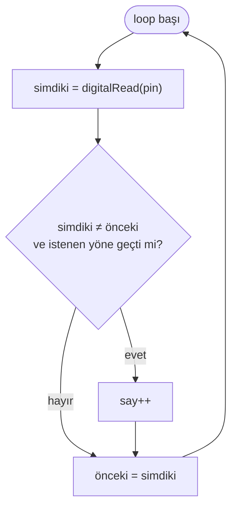
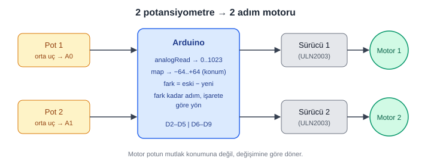
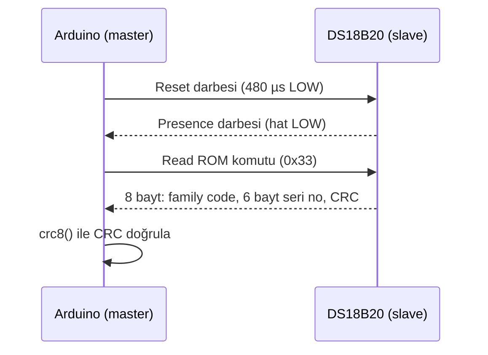

# Arduino Ödevleri ve Sınav Çalışmaları

Gömülü Sistemler dersi için Arduino ile çözülen ödev ve vize hazırlık soruları.
Her sketch kendi klasöründe durur (klasör adı = `.ino` adı), bu yüzden Arduino IDE'de
doğrudan açılır: **File → Open → ilgili `.ino` dosyası**.

Kartlar: Arduino Uno (Nano için de geçerli). Uno'da interrupt pinleri **2 ve 3**'tür.

## İçindekiler

| Klasör | Sketch | Konu |
|---|---|---|
| `01_buton_ve_zaman` | `buton_sayma_10sn` | İlk basıştan sonra 10 sn içindeki basış sayısı (`millis()`, kenar algılama) |
| | `led_cift_basis` | İki basış arası süre < 100 ms ise led yanık kalır, değilse yanıp söner |
| | `periyot_kesmesiz` | İki butonla led periyodu ayarı, **interrupt'sız** (`millis()`) |
| | `periyot_kesmeli` | Aynı soru, **interrupt'lı** (`attachInterrupt`, `volatile`) |
| `02_mesafe_sensoru_urun_sayma` | `mesafe_urun_say` | HC-SR04 ile bantta ürün sayma (histerezis: 85 / 75 cm) |
| | `urun_ayri_say` | 20 cm ve 30 cm'lik ürünleri geçiş süresiyle ayırma |
| | `urun3_say` | 3 çeşit ürün: yükseklik (mesafe) + genişlik (süre) |
| `03_su_deposu` | `su_seviye` | 2 m'lik depo, dolum/boşaltım vanaları (200 cm / 10 cm eşikleri) |
| `04_giris_sayaci` | `giris_sayaci` | AVM giriş sayacı, kenar algılama (önceki/şimdiki durum) |
| `05_kosu_zamanlayici` | `kosu_zamanlayici` | 100 m koşu süresi ve hızı, iki interrupt pini |
| `06_encoder_adim_motoru` | `encoder_adim_polling` | Encoder ile adım motoru, interrupt'sız |
| | `encoder_adim_kesme` | Aynı soru, interrupt'lı |
| `07_dc_motor_ve_enkoder` | `dc_motor_yon` | Sürücü üzerinden DC motor yön/hız (IN1, IN2, PWM, STBY) |
| | `enkoder_hiz_kontrol` | Enkoder geri beslemeli aç-kapa hız kontrolü |
| `08_onewire` | `onewire_read_rom` | 1-Wire reset/presence + Read ROM (0x33), hocanın fonksiyonlarıyla |
| | `onewire_read_rom_kisa` | Aynısının kısaltılmış hali |
| | `crc8_1wire` | CRC-8 (Dallas/Maxim) ödevi, 3 testle (DD, C9, 3A) |
| | `ds18b20` | Kütüphanesiz DS18B20 sıcaklık okuma |
| `09_buton_frekans` | `buton_frekans` | 1. buton → 20 Hz, 2. buton → 10 Hz, ikisi birden → sinyal yok (`millis()`) |
| `10_potansiyometre_adim_motoru` | `pot_adim_motoru` | v1: 2 potansiyometre ile 2 adım motoru (`analogRead`, `map`, wave drive) |
| | `pot_adim_motoru_yarim_adim` | v2: yarım adım dizisi, ölü bölge (±10) ve seri monitör çıktısı |
| `11_pid_motor_hiz` | `pid_hiz_kontrol` | 07'deki aç-kapa kontrolün PID'li hali (Kp, Ki, Kd, anti-windup) *(ek çalışma)* |
| `12_i2c_spi` | `i2c_mpu6050` | I²C ile MPU6050 ivme/jiroskop/sıcaklık okuma, `Wire.h` *(ek çalışma)* |
| | `spi_74hc595` | SPI ile 74HC595 üzerinden 8 led sürme, `SPI.h` *(ek çalışma)* |

## Görsel özet

### Konu haritası

### HC-SR04 ile ürün sayma (02)

### Kenar algılama (butonlar ve sayaçlar)

Sayaç, sinyalin **seviyesine** değil **değişimine** bakar. Bu yüzden basılı tutulan buton tek sayılır.

### Pot ile adım motoru (10)

### 1-Wire Read ROM (08)

## Pin özetleri

| Sketch | Bağlantılar |
|---|---|
| butonlu sketch'ler | Buton → pin 2 (ve 3) ile GND arası, `INPUT_PULLUP` (basılı değilken HIGH, basınca LOW) |
| HC-SR04 sketch'leri | Trig → D9, Echo → D10, VCC → 5V, GND → GND |
| `su_seviye` | Trig D9, Echo D10, dolum vanası D7, boşaltım vanası D8 |
| `kosu_zamanlayici` | Start → D2, bitiş sensörü → D3 (10 kΩ pull-down) |
| encoder sketch'leri | Encoder A → D2, B → D3, sürücü puls → D4, direction → D5 |
| `dc_motor_yon`, `enkoder_hiz_kontrol` | IN1 D4, IN2 D5, PWM D6, STBY D7, enkoder A D2 / B D3 |
| `pot_adim_motoru`, `pot_adim_motoru_yarim_adim` | Pot 1 → A0, Pot 2 → A1, motor 1 → D2–D5, motor 2 → D6–D9 (ULN2003 sürücü üzerinden) |
| `buton_frekans` | Buton 1 → D2, Buton 2 → D3 (`INPUT_PULLUP`), led → D13 |
| `pid_hiz_kontrol` | `enkoder_hiz_kontrol` ile aynı: enkoder A D2, IN1 D4, IN2 D5, PWM D6, STBY D7 |
| `i2c_mpu6050` | SDA → A4, SCL → A5, VCC → 5V, GND → GND, AD0 → GND (adres 0x68) |
| `spi_74hc595` | MOSI D11 → DS, SCK D13 → SH_CP, D10 → ST_CP (latch), 8 led + 220 Ω |
| 1-Wire sketch'leri | Veri hattı → D2, D2 ile 5V arasında 4.7 kΩ pull-up |

## Notlar

- `crc8_1wire` çıktısı her test için `CRC: DD Beklenen: DD`, `Gecerli`, `Hata bulundu` şeklindedir.
  Beklenen değerler (DD, C9, 3A) algoritmanın bağımsız bir uygulamasıyla da doğrulandı.
- `giris_sayaci` tam dosya olarak sohbette yoktu; `loop()` ve `setup()` parçalarından
  birleştirildi. Seri çıktı metni yeni yazıldı.
- `enkoder_hiz_kontrol`: tahta fotoğrafında `Hiz` formülü okunamadı, darbe/sn olarak
  tamamlandı (dosyada belirtildi).
- `onewire_read_rom` ve `ds18b20` donanım gerektirir; diğerleri mantık olarak
  Tinkercad'de de simüle edilebilir.
- Tüm sketch'ler derleme öncesi sözdizimi kontrolünden geçirildi. Gerçek kart
  üzerinde yüklenip denenmedi.
- `11_pid_motor_hiz` ve `12_i2c_spi` dersten gelen sorular değil, 07 ve 08'in devamı olarak
  yazılan **ek çalışmalardır**. PID mantığı basit bir motor modeliyle simüle edilip doğrulandı;
  `Kp, Ki, Kd` değerleri örnektir, gerçek motorda ayarlanmalıdır. MPU6050 ve 74HC595 ile
  gerçek donanımda denenmedi.
- RFID banka/çok imzalı kasa projesi ayrı bir repoda: `rfid-banka-kasa`.
